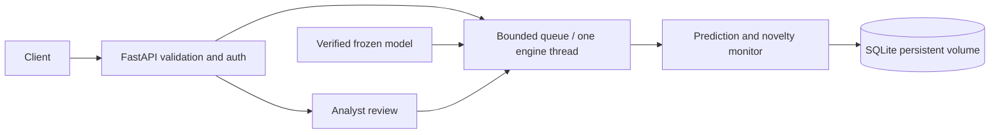

# Scam Variant Observatory

A private demonstration of scam-message scoring, lexical novelty monitoring, and analyst review for Sri Lanka. The selected model is character TF-IDF plus logistic regression, version `svo-38879254a924`. The API is a separate application in `app/server/`.

```bash
docker compose up --build -d --wait
```

Open `http://127.0.0.1:8000/docs`. Docker/Compose is required. The selected model bundle is included at `training/runs/final/bundle/`, so a clone containing these files needs no retraining or separate model download. The first build downloads dependencies. Runtime inference is offline. Default access is local demonstration mode on host loopback.

- [Server setup, API contract, authentication, and operations](app/server/README.md)
- [Server verification evidence](app/server/VERIFICATION.md)
- [Training pipeline and data disclosures](training/README.md)
- [Held-out results and limitations](training/RESULTS.md)
- [API implementation plan](Resources/API_Engine_Plan.md)
- [Impact statement](training/docs/impact.md)
- [Third-party notices](training/docs/THIRD_PARTY_NOTICES.md)



Predictions and drift windows persist without raw message text. Candidate clusters can be reviewed and rejected/confirmed with an audit trail; confirmation does not automatically retrain. Uncalibrated model scores and lexical novelty are distinct. Low risk does not mean safe.

Training uses a supplied CSV with unresolved provenance/licensing plus AI-written, unreviewed multilingual synthetic examples. Keep learned artifacts, images, datasets, and text-bearing evidence private; see the training documentation for source details. Held-out high-risk recall is 69.4%, review workload is 100%, and normal replay false-alert windows are 11.1%. These results do not establish production readiness or validated multilingual fraud protection.

The training folder includes source data, prepared datasets, seeds, trained models, run reports, the two saved evaluation replay databases, and exported bundles. Git still ignores local environments, credentials, other runtime databases, caches, and incomplete encoder downloads. Because the repository includes training data and learned artifacts, keep repository access private while data provenance/licensing remains unresolved. Before committing, inspect `git status --short` and `git diff --cached --stat`, and avoid force-adding ignored files.

Code assistance: OpenAI Codex. Previous-phase material informed engineering practices; its implementation and domain rules were not copied. No staging or commits are performed by this implementation workflow.
