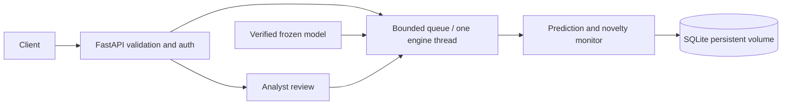

# Scam Variant Observatory

A demonstration of scam-message scoring, novelty monitoring, and analyst review for Sri Lanka. The selected model is `svo-e2a46f504b19` (`e5_tfidf`): a frozen multilingual-E5 embedding plus word/character TF-IDF in one Platt-calibrated logistic regression. The API is a separate application in `app/server/`.

```bash
docker compose up --build -d --wait
```

Open `http://127.0.0.1:8000/docs`. Docker/Compose is required, with about 2 GiB of memory for the API. The selected bundle is at `training/runs/v2/candidates/e5_tfidf/bundle/`. Everything in it is in Git except the 449 MB encoder weights, which the first build downloads at the pinned revision and checks against the bundle's SHA-256 manifest. No retraining is needed, but **the first build needs internet access** (also for dependencies). Runtime inference is offline. Default access is local demonstration mode on host loopback.

- [Server setup, API contract, authentication, and operations](app/server/README.md)
- [Analyst console (React frontend)](app/client/README.md): `docker compose --profile frontend up --build -d --wait`, then open `http://127.0.0.1:8080`
- [Server verification evidence](app/server/VERIFICATION.md)
- [Training pipeline and data disclosures](training/README.md)
- [Held-out results, v1 diagnosis and model comparison](training/RESULTS_V2.md) (v1: [RESULTS.md](training/RESULTS.md))
- [API implementation plan](Resources/API_Engine_Plan.md)
- [Impact statement](training/docs/impact.md)
- [Third-party notices](training/docs/THIRD_PARTY_NOTICES.md)



Predictions and drift windows persist without raw message text. Candidate clusters can be reviewed and rejected/confirmed with an audit trail; confirmation does not automatically retrain. Model scores and novelty are distinct signals. Low risk does not mean safe.

Training uses a supplied CSV with unresolved provenance/licensing plus AI-written, unreviewed multilingual synthetic examples. Keep learned artifacts, images, datasets, and text-bearing evidence private; see the training documentation for source details. Held-out macro-F1 is 0.932 and high-risk recall 98.8%, but high-risk precision is 83.2% (target 90% not met), and the held-out drift replay raised no alert. These results do not establish production readiness or validated multilingual fraud protection.

The training folder includes source data, prepared datasets, seeds, trained models, run reports, the two saved evaluation replay databases, and exported bundles. Git still ignores local environments, credentials, other runtime databases, caches, and incomplete encoder downloads. Because the repository includes training data and learned artifacts, keep repository access private while data provenance/licensing remains unresolved. Before committing, inspect `git status --short` and `git diff --cached --stat`, and avoid force-adding ignored files. The one exception is the encoder's `.cache/huggingface/` metadata inside the v2 bundles: the manifest hashes it, and Hugging Face's own nested `.gitignore` hides it.

Code assistance: OpenAI Codex. Previous-phase material informed engineering practices; its implementation and domain rules were not copied.
