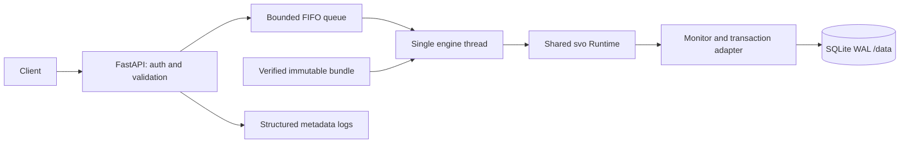

# Scam Variant Observatory API engine plan

Status: implemented in `app/server/`. See [verification evidence](../app/server/VERIFICATION.md) for measured results, environment adjustments, and remaining limits. The sections below preserve the original design decisions.

## 1. Outcome and scope

Build a separate Python API application under root-level `app/server/`. Package the selected trained model and its runtime dependencies into a container. From the repository root, the intended startup command is:

```bash
docker compose up --build -d --wait
```

Prerequisites: Docker with Compose supporting `--wait`, the selected private model bundle available locally, and dependencies/base image obtainable during the first build. After building, inference requires no internet. Initial local startup must not require training, model downloads, or manual database setup.

The first release provides message prediction, durable monitoring, a cluster review queue, and audited analyst decisions. A separate frontend can consume the documented API later. Async jobs, bulk uploads, retraining, E5 integration, cloud infrastructure, and a dashboard are outside this first backend slice.

The user restriction remains binding: do not stage or commit any changes.

## 2. Evidence and decisions

Sources inspected:

- `Resources/Scam_Variant_Observatory_Problem_Statement.pdf` and `Resources/TensorForge 2.0 Grand Finale.pdf`: runnable service, prediction logging, drift signal, and response are core deliverables. These documents do not prescribe an HTTP contract.
- `Resources/Previous_Phase_Practices.md`, especially sections 9–12: reuse artifact verification, training/serving parity, strict API validation, bounded inference, persistence, and container testing. Previous labels, endpoint limits, job features, latency measurements, and AWS architecture are historical examples.
- `training/RESULTS.md`, the final manifest/configuration, and `training/src/svo/{model,monitor,artifacts,preprocessing,serve}.py`: actual handoff is authoritative for runtime behavior.

| Finding | Server decision |
|---|---|
| Selected bundle is `training/runs/final/bundle/`, version `svo-38879254a924`, candidate `tfidf` | Ship this frozen bundle; no transformer or GPU dependency |
| Python 3.12.3 and a pinned runtime requirements file exist | Start with Python 3.12 and preserve ML dependency versions; resolve and pin API dependencies during implementation |
| `Runtime` verifies artifact hashes before loading joblib | Preserve verification and add expected-version/source checks |
| Serialized feature objects depend on the `svo` module path | Preserve that package namespace; do not reimplement preprocessing in API code |
| `Monitor` uses a thread-affine SQLite connection and sequential sequence allocation | One process, one dedicated execution thread owning model and monitor |
| Current HTTP service is an unauthenticated local demonstration | Replace the HTTP boundary with FastAPI, explicit schemas, structured errors, and deployment modes |
| Current monitor commits internally and lacks explicit rollback on failure | Harden transaction handling before serving concurrent HTTP clients |
| No actual HTTP socket smoke test was completed in training | Container and real HTTP verification are required acceptance gates |

The model is a private, unreviewed demonstration. Scores are uncalibrated; novelty is lexical. Held-out high-risk recall is 69.4%, review workload is 100%, and normal replay false-alert windows are 11.1%. No cluster met the candidate rule at replay end. The server must preserve these limitations; packaging does not improve model quality. Do not reinterpret configuration `operating_target_met: true` as held-out success—it records development selection.

## 3. Structure and dependency boundary

```text
app/server/
  pyproject.toml
  requirements.lock          # API + existing ML runtime dependencies
  Dockerfile
  README.md
  src/svo_api/
    main.py                  # app factory and lifespan
    settings.py              # validated environment settings
    schemas.py               # request/response contracts
    errors.py                # common JSON error conversion
    auth.py                  # deployment-mode authentication
    routes/
      health.py
      predictions.py
      monitoring.py
      clusters.py
    services/
      engine.py              # bounded queue; single owner thread
      monitoring.py          # persistence adapter and transactions
    storage/
      migrations.py
  tests/
    test_contract.py
    test_parity.py
    test_persistence.py
    test_container_smoke.py
  scripts/
    verify_runtime.py
    smoke.py
compose.yaml
.dockerignore
README.md
training/                    # preserved training artifacts and shared runtime
Resources/API_Engine_Plan.md
```

The server is a separate application with its own entry point, dependencies, tests, and lifecycle. Reuse `svo` from `training/src/` as the shared ML library rather than maintaining a second model implementation. The image copies only its required modules (`__init__`, `model`, `monitor`, `preprocessing`, `artifacts`, and `data`, which artifact verification imports). It never runs `svo.serve` or training commands. Keep modules byte-identical to manifest source hashes initially.

Add API-specific persistence safety through a narrowly scoped adapter/subclass over `Monitor`, preserving scoring and monitoring rules. If adapting it proves unsafe, extract a shared runtime package as an explicit follow-up with source provenance and parity checks; never silently edit frozen source identity or reseal the trained model as if retrained.

## 4. Runtime architecture



Startup validates settings, verifies bundle checksums and expected model version, checks copied source hashes, loads the model once, and performs a harmless prediction without adding a monitoring event. The engine thread opens SQLite, applies additive schema migrations, and validates writable storage. Only then does readiness become successful. Startup failure exits nonzero with a sanitized diagnostic.

Use one Uvicorn worker and no reload in the container. All monitor operations, including reads and reviews, execute on the same engine thread. ASGI handlers await queued work without blocking the event loop. Health checks read cached lifecycle state and never invoke inference.

Start with a queue capacity of 32 pending operations, configurable and subject to load testing. Reject excess work with `429` and `Retry-After`. Accepted requests are processed in FIFO admission order; concurrent requests have no implied client-time ordering. A disconnected client does not cancel an accepted mutation; clients use event IDs to retry safely. Graceful shutdown stops admission, drains accepted work within a documented grace period, closes SQLite on its owner thread, and exits. This queue is not a durable async job service.

## 5. Proposed HTTP contract

Routes use `/api/v1` except health probes. These are project design choices, not inherited competition rules.

| Method and path | Behavior |
|---|---|
| `GET /health/live` | Public process liveness; no model or database query |
| `GET /health/ready` | `200` only after verified model and storage initialization; otherwise `503` |
| `GET /api/v1/model` | Model/reference version, representation, scope, calibration status, frozen thresholds, and limitations |
| `POST /api/v1/predictions` | Score one message and atomically persist its monitoring effects |
| `GET /api/v1/monitoring` | Version-scoped event count, monitoring readiness, latest window, and queue summary |
| `GET /api/v1/clusters?status=pending&limit=20&after_id=...` | Current-version clusters, stable ID ordering, validated filter, cursor pagination, maximum limit 100 |
| `GET /api/v1/clusters/{id}` | Current-version cluster details and bounded representative event IDs; no raw text |
| `POST /api/v1/clusters/{id}/reviews` | Apply `pending`, `confirmed`, or `rejected`; persist audit entry; return `automatic_retraining: false` |
| `GET /api/v1/clusters/{id}/reviews?limit=20&after_id=...` | Paginated audit history, maximum limit 100 |

Prediction request: `{"text":"The office opens tomorrow.","event_id":"client-generated-id"}`. Require the client event ID for reliable retries: 1–128 characters, a documented URL-safe identifier alphabet. Text must be a nonempty string, at most 10,000 characters, using the existing NFC/whitespace normalization. Reject extra request fields and implicit type coercion. Do not accept caller-supplied labels, thresholds, or model paths.

Prediction response retains runtime field names: `event_id`, `scam_score`, `decision`, `needs_review`, `novelty_score`, `is_unknown`, `nearest_known_family_or_null`, `cluster_id_or_null`, `model_version`, `reference_version`, `scope`; normalize optional `cluster_capacity_reached` to a documented boolean. Scores are finite JSON numbers. Decisions remain `high_risk`, `review`, and `low_risk`. Low risk does not mean verified safe. Novelty and scam score have separate meanings.

Same event ID, normalized text, and model version returns the stored result without incrementing windows or clusters. Same event ID with different normalized text or version returns `409`. Identical text with a different ID is another report, but must not inflate distinct-text recurrence. Global event IDs remain reserved across model versions, matching the existing database behavior.

Review requests include a `review_id` for idempotency and a status. In authenticated mode derive actor identity from the credential mapping; do not trust a caller-provided actor. Local demonstration mode may accept an explicitly unverified analyst alias. Retrying the same review ID/body returns its stored response; conflicting reuse returns `409`. Confirmation records an analyst decision; it does not approve training data or trigger a model update automatically.

Use a common error envelope: `{"error":{"code":"...","message":"...","request_id":"..."}}`. Specify `400` malformed JSON, `401` missing/invalid credentials, `404` unknown resource, `409` idempotency conflict, `413` body too large, `415` unsupported media type, `422` invalid schema, `429` capacity exceeded, and `503` engine/storage unavailable. Unexpected failures return sanitized `500` errors. Never echo input text in validation errors or logs.

Start with a 64 KiB decoded request-body limit, enforced while streaming, including requests without Content-Length; reject unsupported content encoding. This comfortably covers 10,000 UTF-8 characters in ordinary JSON; heavily escaped JSON can still exceed the byte limit. Validate auth before reading protected bodies, then media type, body limit, JSON, and schema. Publish OpenAPI and examples; restrict documentation routes alongside API routes in authenticated mode.

## 6. Persistence and monitoring behavior

Use `/data/observatory.sqlite` in a named Docker volume, WAL mode, a bounded busy timeout, and schema version tracking. Preserve existing events, windows, clusters, and reviews; use a fresh service database rather than importing the evaluation replay database.

Each prediction must commit event, cluster updates, and any new window together. Existing `Monitor.process` already commits on success; the adapter must explicitly roll back on every exception, and serialize the complete operation. Review status and its audit/idempotency record must also be one transaction; the adapter must own this operation instead of adding a second commit after `Monitor.review`. Fault-injection tests must prove no partial updates survive.

Persist no raw message text. Cluster representatives are event IDs obtained from stored prediction membership. An authorized client can retain its own private evidence by event ID. This backend does not yet support reviewing message content independently; richer evidence storage requires a separate privacy/retention design.

Preserve frozen settings: 20-report windows, stride 5, two consecutive elevated windows, maximum 100 clusters, minimum 3 distinct normalized texts for candidate eligibility. Load actual values from bundle configuration, not hardcoded copies. Distinct texts are not proof of independent reporters. Queue status and candidate eligibility are separate fields; a candidate remains a hypothesis even when an analyst confirms it.

First release retains metadata until an explicit operator reset/archive. Do not add automatic deletion that silently changes idempotency, recurrence, or window cadence. Document growth limits, monitor volume free space, and mark storage unavailable on write failure. Add retention with explicit expiry semantics only in a later migration. Use SQLite backup facilities or stop the service for backups; never copy only the active database file while ignoring WAL. Backup/restore and model-version isolation must be tested.

## 7. Container and configuration

- Root Compose uses repository build context and `app/server/Dockerfile`. A strict `.dockerignore` allowlist admits server sources, required runtime modules, runtime requirements, and the exact final bundle only. Exclude private corpora, caches, virtual environments, exports, evaluation databases, notebooks, secrets, and `.git`.
- Build a CPU-only Python 3.12 slim image; pin the tested base digest and resolved dependencies during implementation. Preserve the training ML versions. Check package availability and architecture compatibility early; do not silently replace unavailable pins.
- Verify bundle and source identity during build and again at startup. Hash validation is corruption detection, not publisher authentication: only load the trusted team bundle. Embed the bundle read-only at `/opt/model` and runtime sources in the image. No runtime mounts of the training workspace are required.
- Run as a non-root user. Make only `/data` and temporary storage writable; use a read-only root filesystem, temporary `/tmp`, dropped capabilities, and no-new-privileges. Initialize named-volume ownership in the image and verify it works on a clean volume.
- Bind Uvicorn to `0.0.0.0:8000` inside the container, publish `127.0.0.1:8000:8000` on the host by default. Use a Python readiness probe to avoid a curl dependency. Configure a startup grace period, restart policy, and shutdown grace period.
- Start with one worker and two numerical-library threads. A 2-vCPU/1-GiB container is an initial benchmark profile, not a measured requirement; adjust from evidence.
- Default Compose mode is explicitly `local_demo`: no credential setup and host-loopback exposure. For any nonlocal deployment require authenticated mode and injected API credentials; fail startup if absent. Keep the local mode visible in model metadata. Hosted TLS/proxy configuration is a separate deployment task.
- In authenticated mode use constant-time credential comparison and configured analyst identities; avoid credentials in query strings. CORS is disabled by default and explicitly allowlisted when a frontend is added. Never put shared keys in a built frontend bundle.
- Configuration includes `SVO_MODE`, `SVO_MODEL_DIR`, `SVO_EXPECTED_MODEL_VERSION`, `SVO_DB_PATH`, `SVO_QUEUE_CAPACITY`, `SVO_ALLOWED_ORIGINS`, and credential configuration. Model decision thresholds are immutable artifact settings, not environment overrides.
- Since the current learned artifact has unresolved data provenance, keep the resulting image private. A source-only checkout needs the privately supplied bundle before its first build; fail clearly if it is missing.

Operational commands will include `docker compose logs -f api`, `docker compose stop`, and `docker compose down` (volume retained). Clearly separate destructive volume reset instructions. Rollback uses the prior image plus a compatible database backup; no hot model swap in release one.

## 8. Delivery sequence and acceptance gates

| Step | Deliverable | Exit gate |
|---|---|---|
| 1. Contract and artifact preflight | Schemas, config defaults, runtime dependency lock, artifact/source verification | Selected bundle imports and predicts without training dependencies or network |
| 2. Smallest container slice | App lifespan, worker, health, prediction, root Compose | One command starts a healthy container; one real HTTP prediction succeeds |
| 3. Durable observatory | Monitoring queries, clusters, transactional reviews, idempotency | Restart preserves state; ordered replay matches existing monitoring behavior |
| 4. HTTP hardening | Auth modes, limits, error mapping, CORS, bounded queue | Invalid/oversized/unauthorized requests fail predictably without mutations |
| 5. Verification and handoff | Smoke script, parity tests, operational README, measured evidence | Clean build, offline runtime, persistence, and failure-path checks pass |

Complete the container slice before optional API expansion. If time is constrained, cut richer cluster detail/history presentation before cutting prediction parity, durable monitoring, review audit, or real container verification.

Required verification:

1. Compare multilingual and normalization fixtures against the frozen runtime: identical decisions, flags, versions, and numeric scores within a declared tolerance. Use separate fresh databases for matching event streams because clustering is stateful.
2. Check artifact corruption, absent files, wrong expected version, and source mismatch fail before loading untrusted payloads. Confirm the image excludes private data and training-only dependencies.
3. Exercise real HTTP validation, auth, empty/long/invalid Unicode input, request limits without Content-Length, content-type handling, error sanitization, queue saturation, and health responsiveness.
4. Send simultaneous duplicate event IDs; observe one durable event and one set of monitoring effects. Check conflicting reuse, normalized duplicates, cross-version reuse, review retries, and missing cluster IDs.
5. Inject failures between writes; verify rollback. Restart and verify windows, centroids, review history, idempotency, and model-version isolation. Restore a backup and verify the same behavior.
6. Replay the private shifted fixtures through the API in order and compare resulting windows/clusters with the existing runtime. Demonstrate a persisted review response honestly; do not fabricate a candidate cluster or improved drift result.
7. Build/start on a clean Docker volume, stop/start with the existing volume, and exercise smoke tests against the container. Verify runtime inference with outbound network unavailable while local HTTP remains accessible.
8. Measure startup time, HTTP p50/p95, memory, and health latency under concurrent load on the documented machine. The training 1.54 ms warm inference p95 is not HTTP latency. Proposed initial goals: readiness within 30 seconds and single-request p95 below 250 ms at concurrency 4 on the benchmark profile; these remain unmeasured engineering targets.

Evidence should record the model version, image identifier, source hashes, schema version, dependency lock, hardware, actual test results, and unresolved checks. Do not rerun final model evaluation or tune thresholds from held-out examples while implementing the service.

## 9. Completion criteria

The backend is complete when the documented one-command startup works, the API uses the selected artifact with proven parity, monitoring and reviews survive restart, unsafe inputs and overload are handled, and a clean container passes actual HTTP smoke tests. The README must describe private bundle acquisition, local versus authenticated modes, API examples, persistent storage, backup/rollback, measured performance, and model limitations.

Planning does not authorize publishing an image, deploying infrastructure, staging, or committing. The next implementation work should follow the gates above without changing the trained model's decisions.
