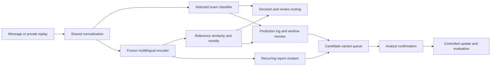

# Scam Variant Observatory — training and MLOps execution plan

Date: 17 October 2026. Status: original design superseded for this execution by the [one-hour training plan](../training/PLAN.md). Implementation, private data, notebooks, measured evidence and exports are under `training/`; see [training README](../training/README.md). The user prohibits staging, commits and pushes, overriding historical commit/submission instructions below.

**Recommendation:** keep the baseline → evaluate → select approach, but make the first deployable system a small trained classifier plus multilingual embeddings, novelty monitoring, and an analyst queue. Compare two mandatory candidates. Allow one short fine-tuning experiment only after the complete detection → drift → response workflow runs. Optimize model size only if a measured runtime or transfer problem requires it.

The current execution budget is **60 minutes**, following the user's latest instruction. The original 240-minute specification below is historical context; optional fine-tuning/compression and the controlled update are deferred. Candidate B is conditional on download/setup time. This is an allocation, not a statement of the current remaining clock time. The official deadline is **14:00 Asia/Colombo on 17 October 2026**; subtract time already spent, including planning. Do not restart a four-hour clock when implementing this file.

## 1. Source of truth and scope

Read these in order before implementing:

1. [TensorForge 2.0 Grand Finale.pdf](<TensorForge 2.0 Grand Finale.pdf>) — binding rules in Section 4; the suggested timetable is advisory.
2. [Scam Variant Observatory problem statement](Scam_Variant_Observatory_Problem_Statement.pdf) — chosen product scope and evaluation commitments.
3. [Previous phase practices](Previous_Phase_Practices.md) — reusable methods and historical evidence only.
4. This document — proposed implementation decisions, internal targets, and fallback choices. Organizer clarifications supersede it.

Only the three source documents were present in `Resources` when this plan was prepared. No current dataset, API contract, training implementation, or measured hardware capacity was available. Dataset counts and runtimes below are budgets, not verified facts. The workspace did not expose a usable Git repository to the planning session; the implementation team must verify/init its actual competition repository and preserve regular commits.

This task produces this Markdown file. The notebook names, folder tree, and interfaces below are requirements for subsequent implementation; they are not claims that those files already exist.

### Current requirements and implications

| Requirement | Source | Plan implication / evidence |
|---|---|---|
| Six-hour build, 08:00–14:00; last pre-deadline commit reviewed | Finale pp. 1, 3–4 | Use remaining time; make meaningful commits throughout; reserve submission time |
| One-line problem submitted in first 30 minutes; changes require committee approval | Finale p. 2, Rule 1 | Verify submission status; retain the chosen observatory problem |
| Data sourced/generated during build; pretrained/open-weight models and AI assistants allowed | Finale pp. 2–3, Rules 2–3 | Download permitted weights; train/adapt now; disclose models, AI tools, and reused templates |
| Core ML, held-out results, reproducible pipeline with pinned dependencies | Finale p. 3, Rules 3–4 | Train classifier; preserve splits, configs, scripts, and measured evidence |
| Prediction logging, drift signal, and response | Finale p. 3, Rule 4 | Make these mandatory before fine-tuning |
| Sri Lankan users; multilingual scope limited to validated coverage | Finale p. 2; proposal | Evaluate English, Sinhala, Tamil, Singlish, Tanglish separately where reviewed examples exist |
| Separate shifted set; translations/paraphrases grouped | Finale p. 2; proposal | Lock groups before training; distinguish new wording, new targets, and unseen mechanisms |
| Controlled update evaluated on examples excluded from retraining | Proposal | Prepare separate update/support and post-update evaluation partitions |
| Runnable service, README, one-page impact statement, PDF deck | Finale p. 3 | Treat model artifacts as one part of the submission |
| No real personal identifiers; synthetic scams restricted to training/testing and never posted publicly | Finale pp. 2, 4 | Keep synthetic message corpora and text-bearing outputs private; publish code/configs/aggregate evidence; give judges controlled access |
| Open-licensed project, attribution, no secrets | Finale p. 4 | Include code licence, third-party notices, tool disclosure, and secret-free artifacts |

The guidelines explicitly prioritize deployment, monitoring, and drift response over raw model performance, but provide **no numerical scoring weights**. Do not invent an official weighted leaderboard. No current requirement repeats Phase 2's 2-vCPU/4-GB constraint, exact API, AWS deployment, 11 classes, or offline runtime. A documented local runnable app is sufficient under the stated service requirement; a container is preferred, and live hosting is optional.

## 2. Evaluation of the proposed workflow

| Your idea | Assessment | Recommended adjustment |
|---|---|---|
| Preprocess before training | Keep | Preserve multilingual text and deception cues; split related examples before augmentation |
| Train a baseline | Essential | Export a working CPU baseline early and put it behind the application |
| Train several candidates and pick a winner | Useful with a cap | Two mandatory candidates, one conditional challenger; compare whole-system feasibility |
| Use pretrained models and fine-tune | Allowed, potentially useful | Start with frozen embeddings and a trained linear head; encoder fine-tuning is optional |
| Optimize winner size afterward | Conditional | First measure download, memory, startup, and inference; skip compression if acceptable |
| Train on Colab, transfer via Drive | Suitable | Run computation on Colab local disk, checkpoint to Drive, download a versioned bundle |
| Repeat the previous phase process | Reuse its discipline | Replace its classifier-first priorities with surveillance and response priorities |

The previous notes report XLM-R winning the old ticket-classification task and a substantial quality loss from INT8 conversion. Those are reasons to compare and validate, not reasons to choose XLM-R here or reject all quantization. Neither that task's labels nor its benchmark scores transfer.

**Definition of the minimum credible product:** a message receives a trained scam score and an independently computed novelty score; recurring unfamiliar reports form an evidence-backed candidate cluster; the analyst can review it; a replay shows normal traffic, a shift, an alert, and a response. The system must not equate novelty with fraud or claim attacker identity, lineage, or forecasting.

## 3. Architecture and model selection



If the embedding classifier wins, reuse its already computed embedding for monitoring. If TF-IDF wins classification, retain the frozen encoder for semantic monitoring and count both components in total size/latency. Choosing the smallest classification head alone does not produce the smallest system.

### Mandatory candidates

| ID | Candidate | Training / role | Maximum experiment allocation |
|---|---|---|---|
| A | Character TF-IDF + logistic regression | Fast trained baseline and CPU fallback | 10 minutes after data preparation |
| B | Frozen `intfloat/multilingual-e5-small` + logistic regression | Preferred starting architecture; shared embeddings for detection and surveillance | 20 minutes, including embedding cache generation; downloads separately monitored |
| C | Same encoder with a small supervised binary head and short encoder fine-tuning | Optional quality challenger only | 20 minutes total, including evaluation and packaging consequences |

**Candidate A defaults:** `analyzer="char"`, n-grams `(3,5)`, `min_df=2`, `max_features=50000`, `sublinear_tf=True`; logistic regression `C` in `{0.5, 2.0}`, `max_iter=1000`, seed 42. Fit vocabulary/IDF on training only. Use `class_weight="balanced"` if training is materially imbalanced, and record that probabilities still require validation. Do not add a large feature search.

**Candidate B defaults:** use normalized 384-dimensional embeddings, the `query: ` prefix for every message, and masked mean pooling if using raw Transformers. The model card specifies these feature/clustering conventions, lists MIT licensing and multilingual coverage including Sinhala and Tamil, and warns that low-resource performance may degrade. Its maximum input length is 512 tokens. This does not establish Singlish/Tanglish quality. [E5 model card](https://huggingface.co/intfloat/multilingual-e5-small/raw/main/README.md)

Set an initial maximum length of 256, inspect truncation by language, and raise it only if necessary and affordable. Cache normalized float32 embeddings. Fit the same two-value logistic-regression grid on training embeddings. Download once and pin the exact hub revision. Do not add PCA, a vector database, or another encoder to this path.

**Candidate C launch gate:** baseline service, logs, and drift replay already work; reviewed data are available; a GPU is allocated; measured step time predicts completion within 20 minutes; and all remaining packaging/rehearsal blocks stay protected. Otherwise record `skipped_due_to_budget`.

For C, start from the same encoder with mean pooling and a binary linear head, cross-entropy loss, learning rate `2e-5`, batch 16 with accumulation if needed, at most two epochs, and a hard elapsed-time cap. Use mixed precision only on supported hardware. Save best validation checkpoint and optimizer state. Run one configuration, not a sweep. Keep the original frozen encoder for monitoring initially: binary fine-tuning can change geometry, and two-weight deployment cost may outweigh gains. Replacing the monitoring encoder would require rebuilding references, clustering thresholds, and all drift evidence; omit that change within this budget.

SetFit is a legitimate alternative for a later experiment: it fine-tunes embeddings and trains a classification head. It is not a fourth candidate here. [SetFit documentation](https://huggingface.co/docs/setfit/index)

### Winner rule

Choose on `val_select`, never on the held-out test or final shifted replay:

1. Reject a candidate that cannot be exported, loaded, or served within the available product resources.
2. Compare scam precision/recall, macro-F1, and false positives on legitimate controls; inspect reviewed language slices with sample counts.
3. Prefer B if it is within **0.02 absolute macro-F1** of A and has acceptable scam recall and runtime, because the encoder is already needed for surveillance. If A wins clearly, use A for classification and B's encoder for monitoring.
4. Promote C only for an improvement of at least **0.02 macro-F1**, without more than **0.02 absolute scam-recall regression**, and with acceptable supported-language behavior and total deployment cost.
5. Record uncertainty and the reason for selection. These deltas are internal engineering rules, not statistically established significance or organizer requirements.

Use provisional validation targets of scam precision ≥0.90 and recall ≥0.80 for a high-risk label, alongside an abstain/review route. If no threshold satisfies both, report that failure and narrow automatic claims; never manufacture a passing score or quietly lower the published target.

## 4. Data acquisition, labels, and preprocessing

### Time-bounded acquisition

Allocate at most 10 minutes to deciding whether a public phishing source is usable. Record source URL/revision, original provenance, licence, attribution, label meaning, privacy status, and retrieval date. Public availability is not sufficient permission, and a licence is not proof that records contain no personal data.

Source screening leads:

| Source | Evidence / decision |
|---|---|
| [IT4LIA phishing collection](https://huggingface.co/datasets/it4lia/PhishingEmailCuratedDatasets_Cleaned) | Card declares CC BY 4.0, but its visible schema includes sender/receiver metadata and combines corpora. Inspect original terms, accessible message bodies, and spam/phishing label mapping before admitting any records; **not approved by this plan** |
| [UCI SMS Spam Collection](https://archive.ics.uci.edu/dataset/228/sms%2Bspam%2Bcollection) | Licence-listed source for an optional auxiliary SMS experiment; spam is not equivalent to fraud. Do not directly relabel spam as scam or claim it satisfies the proposal's phishing-data commitment |
| Team-written and offline LLM-generated examples | Default available path under Rule 2, with generation method, review status, and related-example group IDs recorded |

If a public corpus fails provenance/privacy/label checks, skip it. Use reviewed synthetic data, explicitly document the departure from the proposal's intended public-plus-synthetic mixture, and describe results as a controlled simulation. Do not spend the remaining build searching indefinitely. Do not ingest real personal identifiers into the project; use a vetted identifier-free subset or choose synthetic material. Redaction is a secondary safeguard, not proof that a corpus meets the rule.

Aim for **400–800 reviewed usable messages**, with a lower-budget fallback of **200–300** and visibly wider uncertainty. These totals exclude a separate shifted pool. Prefer additional independent scenarios over many paraphrases of a few seeds. If review capacity cannot support these counts, reduce size and claimed language coverage; do not mark unreviewed generations as reviewed.

Use scam mechanisms such as credential/OTP theft, advance-fee requests, investment deception, and account impersonation. Mechanism labels are analyst annotations for analysis/retrieval, not mandatory multiclass training targets. Reserve one different mechanism, for example remote-access installation deception, for unseen-family evaluation. A new institution using an old credential-theft tactic is a **new target**, not automatically an unseen mechanism.

Include legitimate controls with the same surface cues: bank service notices, delivery updates, security warnings that say never share an OTP, ordinary payment reminders, public information about identity services, unfamiliar organizations, and messages discussing scams. Balance source/style and language across scam and legitimate examples so the model cannot simply learn “generated local text means scam.”

### Minimum record schema

```text
id, text, label                         # label: scam | legitimate; uncertain excluded from fitting
language                               # en | si | ta | singlish | tanglish | mixed | unknown
family, impersonation_target, requested_action
source_id, source_type, license_or_generation_method
scenario_group_id, parent_id, generation_batch_id
human_review_status, synthetic, split
shift_type, event_index                 # evaluation metadata, not model features
```

Inference features are text and any explicitly implemented text-derived signals. Ground-truth family, language annotation, source, split, synthetic flag, event order, and shift labels must not enter the classifier. A visible “synthetic example” banner belongs outside model input and must not leak the class.

### Preprocessing

- Preserve UTF-8 scripts, transliteration, punctuation, emoji, numbers, negation, and instructions such as requests to share credentials. Apply NFC normalization and conservative whitespace cleanup.
- Do not force everything into English, strip non-ASCII text, or remove stop words by default.
- Use fictional placeholders and non-routable example domains in generated samples. Disable link navigation in the demo. Keep masked contact details and URL-shape features consistent between training and inference if used.
- Audit empty text, contradictory labels, exact duplicates, likely paraphrases, unusually long inputs, source/class correlations, and per-language token lengths.
- Keep duplicate counts for monitoring but do not let copied identical messages falsely satisfy an “independent recurring variant” claim.
- Define shared normalization once under `src/svo/preprocessing.py`; notebooks and runtime import it.

The offline adversarial generator should accept scenario seeds and mutation axes: wording, script/language mix, fictional institution, requested action. Human-review the resulting label and plausibility. Generate locally or through an allowed API with private storage; it is a test-data tool, not a public product feature. The hypothetical SL-UDI scenario must be labelled synthetic and hypothetical, including on slides.

## 5. Split design and leakage controls

Allocate **scenario groups**, not individual rows. All translations, paraphrases, mutations of a seed, and linked duplicates stay in the same partition. Create group/split assignments before generation where possible. For imported data, consolidate related records before splitting. Record both message counts and independent-group counts.

| Partition | Suggested allocation | Permitted use |
|---|---|---|
| `train` | 60% of in-distribution groups | Fit TF-IDF, classifiers, optional encoder; build fixed reference bank |
| `val_select` | 15% | Choose candidate/hyperparameters, inspect errors, choose preprocessing |
| `val_cal` | 10% | Fit operating thresholds and drift thresholds after selection; optional calibration only if adequately populated |
| `test_id` | 15% | One final pre-update report after configuration freeze |
| `shift_dev` | Separate scenarios | Develop clustering/monitoring behavior; not final drift evidence |
| `shift_demo` | Separate locked scenarios, target 100–200 messages | Final ordered replay with known shift onset and benign controls |
| `update_train` | Separate preassigned support groups | Analyst-approved examples used in the controlled update |
| `update_val` | Separate support groups | Select updated operating point and promotion decision |
| `post_update_test` | Separate locked groups | Once-only before/after comparison on old and new patterns |

Percentages apply only to the first four partitions; counts may vary to retain both classes. With very small data, merge `val_select` and `val_cal` into a single development set and explicitly record reuse and extra optimism; keep `test_id`, `shift_demo`, and `post_update_test` isolated. Do not claim independent calibration evidence in that fallback.

For unknown-family tuning, use a development family withheld from training that differs from the final held-out family. If data cannot support that, tune only on known/benign development traffic and label unknown-family evidence as a limited single-scenario test.

Do not fit IDF, scaling, reference centroids, novelty cutoffs, or calibration on the final sets. Frozen-encoder transforms may be cached for all partitions, but evaluation labels stay inaccessible to training/selection routines. Reuse neither the same transformed seed across splits nor public pretrained-model test performance as project evidence. These controls follow the general train-only fitting principle in [scikit-learn's leakage guidance](https://scikit-learn.org/stable/common_pitfalls.html).

## 6. Monitoring, novelty, clusters, and response

### Two separate scores

`scam_score = P(scam | text)` from the selected classifier. Until calibration is assessed, call it a model score rather than a reliable real-world probability.

For normalized embedding `z` and a frozen training reference bank `R` containing legitimate and scam examples:

```text
novelty(z) = 1 - max(cosine(z, r) for r in R)
unknown(z) = novelty(z) > novelty_threshold
```

Exclude the same record/group when measuring training-reference diagnostics. Use validation-to-training distances for thresholds. Keep a separate scam-reference bank for nearest known mechanism and evidence retrieval, but never force every report into a known family. A full reference bank is acceptable for hundreds/thousands of examples; measure growth before introducing approximate search.

Choose the novelty threshold on `val_cal`, initially near its 95th percentile of known-message novelty, then validate the actual unknown rate and benign false alerts. Cosine similarity is not confidence. Do not copy an arbitrary cosine cutoff from a different encoder or from the old phase.

**Critical routing rule:** compute novelty for every message, including confidently predicted legitimate ones. Otherwise unknown scams missed by the classifier never reach surveillance. A novel report can enter an “unfamiliar, unconfirmed” queue without being labelled fraudulent.

### Drift monitor

Start with a rolling **50-report window**, evaluated every 10 new reports:

- unknown-message fraction;
- low-confidence/review fraction;
- scam-score distribution; optionally script proportions as a diagnostic.

Set the alert threshold using repeated group-aware, normal-only development replays with the same overlapping-window logic. Choose it to target at most **5% of normal windows** triggering; require two consecutive elevated windows. This is an internal target with finite-sample uncertainty, not a guaranteed false-positive rate. Persist window size, cadence, reference version, thresholds, and minimum sample count. Before sufficient data, display “insufficient observations.”

Use a documented short-window demo mode only if necessary, and evaluate/report that exact mode. Do not silently alter thresholds to make the live replay fire. Input drift is a review signal; without new labels it does not prove accuracy degradation or concept drift.

### Recurring-pattern clusters

Use a bounded recent buffer of unfamiliar or suspicious reports. Begin with incremental cosine clustering: assign to the closest centroid above a development-selected similarity threshold, otherwise create a new cluster; update and renormalize the centroid. This is simpler to ship than a large clustering stack. Check cluster coherence on `shift_dev`, including language mixing and benign novelty.

Create a candidate-variant alert when a cluster contains at least **three distinct normalized message hashes** and meets the selected cohesion/novelty rule. This recurrence count is a configurable starting hypothesis. Repeated identical reports may increase volume but must not establish three distinct variants. Distinct text is not proof of independent sources; preserve that limitation.

Show cluster ID, unique/report counts, first/last seen, representative sanitized examples, nearest known mechanism, novelty statistics, and model/reference versions. An analyst confirms, rejects as benign novelty, or leaves pending. Avoid an LLM-generated family name presented as established truth.

### Demonstrated response and controlled update

When drift fires, create an internal alert and route affected/unfamiliar reports for review. Use a cautious user message such as “Needs review; verify through an independently obtained official channel.” Do not auto-block accounts or automatically retrain on model predictions.

For the update demonstration, use only analyst-confirmed `update_train` groups, refit the cheap head using original training data plus those groups, and use `update_val` for thresholds/promotion. Add confirmed references only to a new version of the bank. Re-estimate novelty thresholds on `update_val`; never silently replace the old reference baseline. Keep the old artifact for rollback.

Choose the update on development evidence; then evaluate old and updated artifacts on untouched `post_update_test`, containing both old and new scenarios. Report new-pattern recall, old-pattern regression, benign false positives, workload, and counts. If using those final results to change the update, they become development results and a new final set is needed. If time prevents updating, ship the alert/review response required by the rules and explicitly mark the proposal's controlled-update demonstration incomplete.

## 7. Evaluation and acceptance evidence

| Area | Required measurements |
|---|---|
| Known-scam classification | Precision, recall, scam F1, macro-F1, PR-AUC where defined, confusion matrix, class counts |
| Languages | Same core metrics and group/message counts per reviewed language; unsupported or tiny slices explicitly flagged |
| Score quality | Reliability plot/Brier score where feasible; no claim of calibration from `predict_proba` alone |
| Unseen mechanism | Binary scam recall and review-routing recall separately; both with denominators |
| Benign novelty | Fraction incorrectly labelled high-risk and fraction generating candidate alerts/review |
| Drift | Normal-window false-alert rate, shifted-window detection rate, first alert after onset, missed-shift replays |
| Candidate clusters | Alert precision against scenario annotations, cluster coherence, reports until first candidate alert |
| Review workload | Messages queued per 100 reports, unique clusters per replay, unresolved queue size |
| Runtime | Cold start, warm p50/p95 latency, batch replay duration, peak memory, complete bundle bytes; hardware named |
| Update | Same untouched post-update set before/after; old/new behavior and workload, with artifact versions |

Define alert delay in both total reports after onset and shifted reports consumed before alert; report “not detected” rather than dropping missed runs. Preserve stream order and prevalence. Use several predetermined replay seeds if time permits, and report all of them, not the most successful replay. Include pure benign language/target shift so a detector cannot look successful simply by alarming on every unfamiliar message.

Report classifier predictions before abstention as well as final routed outcomes; routing everything to review is not high classifier recall. Report traffic composition because precision and workload depend on prevalence. If confidence intervals are computed, resample scenario groups rather than treating translated rows as independent observations.

Logistic regression can still be miscalibrated under domain shift. Add sigmoid calibration only with adequate independent calibration data and time; otherwise document uncalibrated scores. Fit calibration after candidate choice and outside final test data. [scikit-learn calibration documentation](https://scikit-learn.org/stable/modules/calibration.html)

### Selection, freeze, then report

Export the provisional winner before final evaluation. Validate export/parity and any optimization on development data. Freeze artifact/config hashes, then run `test_id` and `shift_demo` once for final reporting. A bad result must be reported; if it drives changes, record that the set is no longer untouched.

Internal operational targets: CPU single-message p95 ≤2 seconds after warmup on the named demo machine, all fixture outputs load successfully, normal replay false-alert rate ≤5%, and a candidate alert before the chosen shifted scenario ends. Targets are subject to honest measurement, not official limits. Do not require every language to meet a numerical threshold on an inadequate sample.

## 8. Colab and Drive workflow

Use one Colab session and one model download. Colab does not guarantee resources, GPU type, or unlimited runtime; Drive also introduces I/O constraints. Keep the CPU path viable. [Google Colab FAQ](https://research.google.com/colaboratory/faq.html)

1. Upload the project bundle and private datasets to `MyDrive/ScamVariantObservatory/`. Restrict access to team/judges as appropriate.
2. Set `DRIVE_ROOT=/content/drive/MyDrive/ScamVariantObservatory` and `WORK_ROOT=/content/svo`. Mount Drive, then copy code/data to `WORK_ROOT` for computation.
3. Install a tested, pinned dependency file. Run import, model-load, and two-message inference checks before long work. Record Python, package, CUDA, device, and model revision details.
4. Execute data preparation and A first. Write its export to Drive immediately so later failures do not erase the fallback.
5. Download B once, benchmark a 100-message embedding sample, project runtime, and cache embeddings keyed by data hash + preprocessing hash + encoder revision + prefix + max length + pooling.
6. Train/evaluate from local disk. Save after every stage and every optional training epoch, first to a temporary local path then to a completed versioned Drive directory. Include a completion manifest; a directory's existence alone does not prove a complete checkpoint.
7. Run monitoring/evaluation/export. Zip the runtime bundle separately from private evaluation data and training checkpoints; include SHA-256 checksums.
8. Download `runtime_bundle_<version>.zip` and aggregate evidence. Extract locally into `artifacts/<version>/`, verify hashes, and point the service at that version. Do not copy training checkpoints over the current winner.
9. Load the artifact without hub access and run the same fixtures locally. Offline load is a robustness choice, not a new organizer requirement. Keep setup download instructions if model weights are distributed outside Git.

Prefer narrow package dependencies: NumPy, pandas, scikit-learn, joblib, PyTorch, Transformers/Sentence Transformers, plus the chosen service package. Verify compatible versions in the implementation environment, then pin them; this planning file deliberately does not invent tested version numbers. Preserve the installed environment record and model licence. No online model-hub dependency should surprise the live demonstration.

## 9. Folder structure and notebook contracts

Proposed structure to generate in the implementation step:

```text
ScamVariantObservatory/
├── README.md
├── LICENSE
├── THIRD_PARTY_NOTICES.md
├── requirements-colab.txt
├── requirements-runtime.txt
├── .gitignore
├── Resources/
│   └── Scam_Variant_Observatory_MLOps_Plan.md
├── configs/
│   ├── experiment.yaml
│   └── runtime.json
├── notebooks/
│   ├── 01_data_and_baseline.ipynb
│   ├── 02_embeddings_and_selection.ipynb
│   ├── 03_monitoring_evaluation_export.ipynb
│   └── 04_optional_finetune.ipynb
├── src/svo/
│   ├── data.py
│   ├── preprocessing.py
│   ├── splits.py
│   ├── embeddings.py
│   ├── train.py
│   ├── evaluate.py
│   ├── monitor.py
│   ├── update.py
│   └── artifacts.py
├── scripts/
│   ├── generate_private_scenarios.py
│   ├── replay.py
│   └── verify_bundle.py
├── data/                              # private; excluded from public Git
│   ├── accepted_sources/
│   ├── processed/
│   ├── splits/
│   └── replay/
├── cache/                             # regenerable; ignored
├── runs/<run_id>/
│   ├── config.json
│   ├── environment.txt
│   ├── metrics.json
│   └── checkpoints/                   # ignored
├── artifacts/<version>/
│   ├── encoder/                       # exact frozen weights/tokenizer/config
│   ├── classifier.joblib
│   ├── vectorizer.joblib              # only when TF-IDF is selected
│   ├── optional_classifier_encoder/   # only if C is promoted
│   ├── reference_bank.npz
│   ├── reference_metadata.json        # IDs/labels; no raw message text
│   ├── preprocessing.json
│   ├── decision_config.json
│   ├── model_card.md
│   └── manifest.json
├── exports/                           # zip bundles; ignored
├── evidence/
│   ├── data_sources.md
│   ├── split_manifest.json            # IDs/hashes/counts, not message text
│   ├── experiment_ledger.csv
│   ├── scorecard.json
│   ├── drift_replay_metrics.json
│   └── update_comparison.json
├── app/
│   └── main.py
├── tests/
│   ├── test_split_integrity.py
│   ├── test_runtime_parity.py
│   └── test_drift_response.py
├── Dockerfile                         # if container fits remaining time
└── docs/
    ├── impact.md
    └── pitch.pdf
```

Publish only approved aggregates and metadata from `runs/` and `evidence/`; predictions, examples, notebook outputs, logs, and fixtures may contain synthetic scam text and must stay private. The repository's open code licence does not override source-data restrictions. Provide judges a private evaluation-data bundle with instructions, hashes, and access details; never publish the private Drive URL in a public README.

### Notebook responsibilities

| Notebook | Inputs | Outputs / stop condition |
|---|---|---|
| 01 | Config, admitted private data | Schema/privacy review records, fixed splits, baseline A, metrics, immediately usable export |
| 02 | Fixed splits and A evidence | Frozen embeddings, B head, development comparison, selected candidate; no final test scores |
| 04, optional | Completed working pipeline, fixed train/dev | Time-capped C checkpoint and comparison; rerun selection only if justified |
| 03 | Frozen selection, reference data, private replay/support sets | Tuned monitoring, parity checks, optional update, final untouched evaluation, bundle and scorecard |

Normal order: **01 → 02 → 03**. If C is eligible, run **01 → 02 → 04 → finalize selection → 03**. Notebook 03 must expose distinct development and final-report stages with an explicit freeze manifest, so routine reruns do not accidentally inspect the final sets.

Notebooks must be thin wrappers around `src/svo/`, runnable top to bottom in a fresh session, and resumable from explicit artifacts. First cell: purpose, required inputs, estimated cap, skip behavior. Shared setup: mount, configurable paths, dependency check, seed, device, run ID, remaining-time check. Last cells: summarize decisions, save metrics, verify completion manifest, copy to Drive. Do not rely on variables left in memory by another notebook.

### Artifact and service handoff

`manifest.json` records format/version, encoder revisions, selected candidate, source code identity where available, data/split hashes, seed, packages, file hashes, and paths. `decision_config.json` contains class order, score/review thresholds, novelty/cluster thresholds, window cadence, minimum observations, reference version, and any calibration parameters. Package preprocessing, pooling, prefix, truncation, and normalization exactly.

Proposed internal runtime interface, not an official API:

```text
predict(text) -> {
  scam_score, decision, needs_review, novelty_score, is_unknown,
  nearest_known_family_or_null, cluster_id_or_null,
  model_version, reference_version
}
```

Use `decision` values such as `high_risk`, `review`, and `low_risk`; never equate `low_risk` with verified safety. A compact Streamlit app with shared Python modules is the default fastest service. Use FastAPI only if a separate frontend already requires it. Show actual model outputs, logs, rolling metrics, and queue state. Persist predictions/alerts/review decisions in SQLite or another simple durable local store. Log scores, versions, event IDs, and timings by default; keep raw messages out of general logs.

## 10. Superseding one-hour execution budget

Follow [training/PLAN.md](../training/PLAN.md), which replaces the former four-hour schedule and cut rules.

| Budget | Work |
|---|---|
| 0–10 min | Inspect data, environment, private storage and source limitations |
| 10–25 min | Group/split data, multilingual synthetic controls, CPU baseline |
| 25–40 min | Conditional frozen E5 comparison, monitoring and analyst response |
| 40–50 min | Leakage/parity/persistence/API checks, select and freeze |
| 50–60 min | Once-only final evaluation, private bundle and documentation |

All training files belong under `training/`, including the original folder proposal's configs, notebooks, shared source, scripts, data, runs, artifacts, exports and tests. Do not stage, commit, push or submit anything in this session. No GPU fine-tuning, compression, cloud deployment or full dashboard is required for this reduced training handoff. Use an explicitly reported short-window demo monitor. If source/review status is unresolved, results are a private unreviewed demonstration, not validated product evidence. Preserve update partitions without claiming an approved controlled update.

## 11. Optimization policy

Start with inference mode, batched encoding, local model caching, a justified token length, bounded reference/buffer sizes, and one encoder shared across components. Keep optimizer states and rejected models out of the runtime ZIP. These steps may solve the actual size/latency problem without changing predictions.

Quantization/ONNX/FP16 conversion is a **maximum 10-minute optional experiment** only if the unoptimized artifact misses a measured operational need and protected delivery time remains. Otherwise ship the working representation. Do not assume FP16 saves CPU compute or that INT8 preserves embedding neighborhoods.

Validate on development fixtures: classification macro-F1 loss ≤0.005, scam recall loss ≤0.01, decision agreement ≥99%, and no material degradation in benign false-alert rate, cluster assignments, or alert timing. A changed embedding space requires regenerated references and revalidated thresholds even if classification matches. Keep original and optimized artifacts; choose before final test. These are internal gates and may be inconclusive on small samples.

## 12. Submission evidence and AI implementation instructions

The canonical `scorecard.json` must distinguish targets from measurements and include candidate/version, data counts/groups, split hashes, supported languages, per-slice metrics, runtime hardware, drift behavior, review workload, update status, and known failures. Unknown or unmeasured values remain `null`/`not_run`; never invent them. Render README/deck numbers from this record.

Meaningful verification before submission:

- Split IDs and related scenario groups do not overlap; unseen final mechanism was absent from fitting; training features exclude label/source metadata.
- The same multilingual fixtures produce matching decisions in notebook and downloaded runtime; version/hash checks catch missing or wrong files.
- Novelty still processes messages predicted legitimate; benign-new-target controls can be rejected by analyst review.
- Ordered replay produces persisted logs, measurable signal, and a real response; duplicate copies do not fake independent recurrence.
- The update contains only approved support groups; final post-update examples were excluded from fitting and selection.
- Documented startup works from a clean environment; private corpora, outputs, credentials, and personal identifiers are absent from the public repository.
- README, impact statement, architecture, licences/tool disclosure, PDF deck, and repository access are ready before the actual deadline.

Pitch evidence: show a normal message; replay an unfamiliar recurring pattern; show the alert and its representative evidence; let the analyst confirm or reject; show measured update results if completed. State that simulations demonstrate surveillance behavior, not real-world fraud prevalence or proven financial losses prevented. Describe a realistic pilot with an analyst organization and measurable review/detection outcomes; present reach estimates as assumptions unless independently sourced.

Use this prompt for the implementation AI:

> Read the three competition resources and `Resources/Scam_Variant_Observatory_MLOps_Plan.md`. Treat the finale rules as authoritative and previous-phase material as historical. Check actual time remaining until 14:00 Asia/Colombo. Implement the mandatory path first: grouped data splits, TF-IDF baseline, frozen multilingual E5 plus trained head, independent novelty monitoring, recurring candidate clusters, and analyst review. Generate the three mandatory Colab notebooks and shared modules with the specified Drive/local paths, stage checkpoints, model revisions, and artifact manifests. Keep synthetic scam data and text-bearing outputs private. Fit no preprocessing or thresholds on final sets. Do not begin optional fine-tuning until the service, logs, drift replay, and response work and the deadline gates permit it. Produce honest held-out evidence, a downloadable runtime bundle, local inference parity checks, and the required product documentation. Record skipped work and failed targets. Do not inherit Phase 2 API/cloud constraints or claim pretrained language coverage proves task quality.

The recommended deliverable is a reproducible, measured observatory with a small trained detector and a working response loop. Encoder fine-tuning is an experiment to earn its place in that product.
