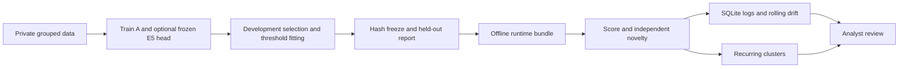

# Scam Variant Observatory training

CPU training, multilingual preparation, frozen-model evaluation, novelty
monitoring and a local API. Everything for this workflow is under `training/`.
The executed scope is a **private unreviewed demonstration**, not validated
fraud protection. See [PLAN.md](PLAN.md) for the one-hour budget decisions.

> **v2 training process.** The v1 run below learned a masking shortcut. See
> [RESULTS_V2.md](RESULTS_V2.md) for the diagnosis, the fixes and the side-by-side
> comparison. Reproduce v2 (Windows paths shown; use `bin/` on POSIX):
>
> ```bash
> python training/scripts/add_public_controls.py      # base + UCI ham -> messages_v2.jsonl
> training/.venv/Scripts/python training/scripts/download_encoder.py
> PYTHONPATH=training/src training/.venv/Scripts/python -m svo.train_v2 \
>   --data training/data/processed/messages_v2.jsonl \
>   --encoder training/cache/multilingual-e5-small --run training/runs/v2 --simulation
> PYTHONPATH=training/src training/.venv/Scripts/python -m unittest discover -s training/tests
> # Once only, after freeze:
> PYTHONPATH=training/src training/.venv/Scripts/python -m svo.evaluate_v2 \
>   --data training/data/processed/messages_v2.jsonl --run training/runs/v2 --simulation
> ```

## Setup

Run from the repository root. Python 3.12 was used. A working environment is
already at `training/.venv`; to reproduce on another machine:

```bash
python3 -m venv training/.venv
training/.venv/bin/python -m pip install -r training/requirements-runtime.txt
# Only for E5 training or E5 runtime:
training/.venv/bin/python -m pip install -r training/requirements-training.txt
export PYTHONPATH=training/src
export OMP_NUM_THREADS=2
export OPENBLAS_NUM_THREADS=2
```

The training lock pins the tested environment, including CPU PyTorch. The
runtime lock is sufficient only for TF-IDF. E5 requires the training lock and
the bundled encoder files. No GPU, model hub or external API is needed after
the selected bundle has been transferred.

## Reproduce

The private seed file and source CSV are included in this repository for team
reproduction. Keep repository access private; data review remains unresolved.
Keep the original data untouched. Preparation refuses to overwrite its output.

```bash
training/.venv/bin/python training/scripts/prepare_data.py \
  --csv training/final_dataset_output.csv \
  --seeds training/data/private/seeds.json \
  --allow-unverified-source --output training/data/processed/messages.jsonl

PYTHONPATH=training/src training/.venv/bin/python -m svo.train \
  --data training/data/processed/messages.jsonl \
  --run training/runs/my_baseline --simulation

# Optional frozen encoder comparison, before looking at final results:
HF_HOME=training/cache/huggingface HF_HUB_DISABLE_XET=1 \
  training/.venv/bin/python training/scripts/download_encoder.py
PYTHONPATH=training/src training/.venv/bin/python -m svo.train \
  --data training/data/processed/messages.jsonl \
  --encoder training/cache/multilingual-e5-small \
  --run training/runs/my_comparison --simulation

PYTHONPATH=training/src training/.venv/bin/python -m unittest discover -s training/tests -v

# Choose the final run before this command. Evaluation is once-only per run:
PYTHONPATH=training/src training/.venv/bin/python -m svo.evaluate \
  --data training/data/processed/messages.jsonl \
  --run training/runs/my_comparison --simulation
```

Creating another run does not make the same test set untouched again. If final
results drive changes, disclose reuse and collect new independent test groups.
`FINAL_EVALUATION_STARTED.json` guards accidental repeat evaluation, including
after an interrupted run. Preserve incomplete evidence and investigate failures.

The notebooks in `notebooks/` wrap these same commands in order 01 → 02 → 03.
They do not duplicate training logic. Colab is optional and was not used for the
local execution. Mount/copy paths are documented in each notebook.

## Data and evidence

- Source CSV: user-provided, unknown provenance/licence, unreviewed. It contains
  no explicit legitimate class. A maximum of 400 masked English rows from
  banking/delivery/government/telecom is admitted by the demonstration importer.
  Spam is not relabelled as legitimate or automatically equated with fraud.
- Synthetic seeds: AI-written fictional scenarios in English, Sinhala, Tamil,
  Singlish and Tanglish; no human review claimed. Both labels use the same style.
  Source and generation notes are in `data/processed/messages.audit.json`.
- Related source templates are consolidated by sanitized fingerprints and
  cosine similarity before hash-based group splitting. Synthetic translations
  and variants retain preassigned scenario groups. Semantic leakage review
  remains incomplete; the automatic checks are not a substitute.
- `train` fits vocabulary, IDF and classifier/reference bank. `val_select`
  selects C/candidate. `val_cal` sets score and novelty/drift cutoffs. `shift_dev`
  selects clustering similarity. `test_id`, `shift_demo`, `post_update_test`
  are held out. Update support partitions are unused without approved labels.
- The 20-report rolling replay uses its real stream order and reports missed
  alerts. A separate benign-only replay measures nuisance signals. All evidence
  stays private under `runs/<run>/`; aggregate results are summarized in RESULTS.md.

Scores are uncalibrated. The high-risk target is precision ≥0.90 and recall
≥0.80 on development data. When it cannot be met, high-risk automation is
disabled; uncertainty still goes to review. A low-risk result is not proof of
safety. Review workload includes high-risk and unfamiliar messages.



## Application handoff

Use the selected path recorded in `RESULTS.md`. Example commands:

```bash
training/.venv/bin/python training/scripts/verify_bundle.py training/runs/final/bundle
training/.venv/bin/python training/scripts/predict.py \
  --bundle training/runs/final/bundle --text 'The office opens tomorrow.'
PYTHONPATH=training/src training/.venv/bin/python -m svo.serve \
  --bundle training/runs/final/bundle --db training/runs/service.sqlite
```

The local service binds `127.0.0.1:8000`. It is a synchronous demonstration API,
not an authenticated public deployment. Routes:

| Route | Body / result |
|---|---|
| `GET /health` | Actual loaded version and demonstration scope |
| `POST /predict` | `{"text":"...", "event_id":"optional-id"}`; score, decision, review, novelty, cluster/version |
| `GET /status` | Latest rolling window and persistent cluster queue |
| `POST /review` | `{"cluster_id":1,"status":"rejected","actor":"analyst-alias"}`; audited review action |

Review status accepts `confirmed`, `rejected`, `pending`. Confirmation never
trains automatically. General logs and SQLite events contain hashes/scores,
not message text. A private client can retain original evidence keyed by event
ID; the API does not expose representative message text. SQLite survives
restart, including cluster centroids and review actions. The number of clusters
is capped; events remain on disk and require an operational retention policy.

Unzip `exports/runtime_bundle_<version>.zip` in a private location, install its
requirements, and set `PYTHONPATH=src`. Verify `bundle/manifest.json` before
loading. The ZIP contains inference source as well as weights/configuration.
Only load trusted team-generated joblib files. Checksums detect corruption;
they are not signatures proving who produced an artifact. Preserve the previous
bundle and database for rollback; model versions isolate monitoring state.

## Known limits and disclosures

Unknown licence and incomplete privacy/label review remain unresolved. Masking
can remove useful semantics and is not proof that all personal data were found.
Real scams versus synthetic legitimate examples confound source with class.
Each local-language held-out slice has very few independent scenario groups.
No reviewed Sinhala/Tamil/transliteration quality, real-world accuracy, prevented
financial loss, or production readiness is claimed.

TF-IDF novelty is lexical if selected. E5 novelty is semantic but still not
fraud probability or evidence of concept drift. Distinct wording does not prove
independent reports, attacker identity, lineage or a new fraud mechanism.

Fine-tuning, compression, controlled model update, dashboard, hosting and final
competition submission are deferred. No staging, commits or pushes were made.
Code and seed writing used OpenAI Codex. No previous-phase implementation was
copied. See `docs/THIRD_PARTY_NOTICES.md` for dependencies and model attribution.
